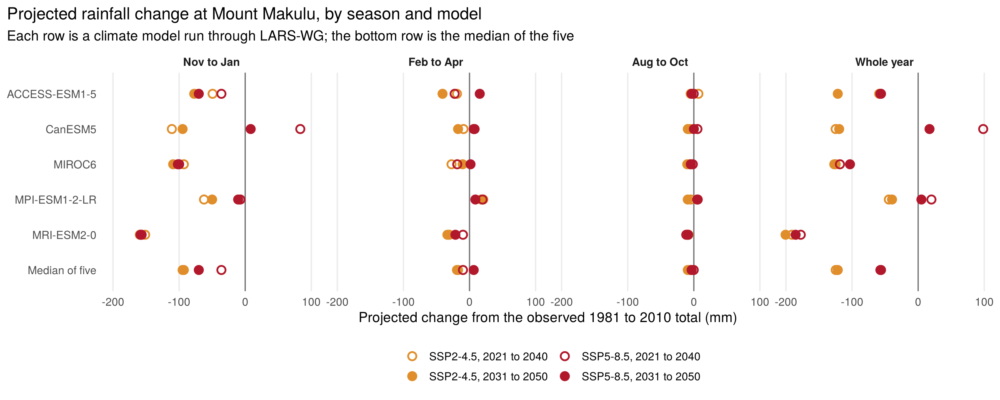
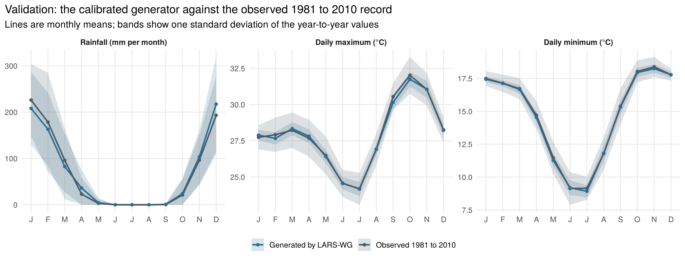

# Mount Makulu Climate Projections, 2021 to 2050

**How much hotter and drier could Zambia's central agricultural research station get by 2050? Five CMIP6 models downscaled to daily weather with the LARS-WG 8 weather generator, calibrated and validated on 30 years of station records.**

**Interactive dashboard and full write-up:** https://memorydube807.github.io/projects/lars-wg-climate-analysis/



Global climate models work on grid boxes 100 to 250 km across. Crop planning needs the weather at one place, day by day. I used the 1981 to 2010 daily record from Mount Makulu (Chilanga, just south of Lusaka) to calibrate LARS-WG 8 and to validate it against what was actually measured. I then fed the generator the changes projected by five CMIP6 models under two emissions scenarios and generated 100 years of daily weather for 2021 to 2040 and 2031 to 2050. Every result is a future projection set against the observed 1981 to 2010 baseline.

## Findings

Projected change from the observed 1981 to 2010 baseline: median of the five models, with the lowest and highest model in brackets.

| | Observed 1981 to 2010 | SSP2-4.5, 2021 to 2040 | SSP2-4.5, 2031 to 2050 | SSP5-8.5, 2021 to 2040 | SSP5-8.5, 2031 to 2050 |
|---|---|---|---|---|---|
| Daily maximum, change (°C) | 28.0 °C | +1.4 (+0.4 to +2.9) | +1.8 (+0.5 to +2.9) | +1.5 (+0.4 to +3.1) | +2.1 (+0.7 to +3.5) |
| Daily minimum, change (°C) | 14.8 °C | +1.0 (+0.5 to +1.7) | +1.5 (+0.7 to +1.8) | +1.2 (+0.5 to +1.8) | +1.8 (+0.9 to +2.2) |
| Annual rainfall, change (mm) | 841 mm | -125 (-191 to -44) | -122 (-201 to -40) | -57 (-178 to +98) | -56 (-185 to +17) |
| Models drier than the baseline | | 5 of 5 | 5 of 5 | 3 of 5 | 3 of 5 |
| Days of 35 °C or more a year | 7.6 | 19 (11 to 43) | 27 (10 to 43) | 20 (10 to 49) | 29 (12 to 60) |
| Nights of 20 °C or more a year | 14 | 46 (28 to 70) | 64 (30 to 71) | 48 (25 to 74) | 75 (35 to 96) |

Every run is warmer than the baseline, and the very hot days cluster in September to November, at the end of the dry season and the start of planting. Most runs are drier, with the loss concentrated in November to January, which carries 62% of the year's rain and loses 36 to 95 mm in the median. MRI-ESM2-0 is the driest model and MIROC6 the hottest.

The choice of model matters more than the choice of scenario before 2050. For annual rainfall the five models span 150 to 280 mm within each scenario, while the two scenario medians differ by about 65 mm.

## Calibration and validation

LARS-WG was calibrated on the observed 1981 to 2010 series, then used to generate a synthetic 1981 to 2010 that was tested against the observations.

| What is compared | Test | Pass at the 1% level |
|---|---|---|
| Wet and dry spell lengths | Kolmogorov-Smirnov | 7 of 8 |
| Daily rainfall amounts | Kolmogorov-Smirnov | 10 of 10 |
| Monthly mean rainfall | t-test | 12 of 12 |
| Year-to-year variation in monthly rainfall | F-test | 9 of 10 |
| Daily minimum and maximum temperature | Kolmogorov-Smirnov | 24 of 24 |
| Monthly mean minimum and maximum temperature | t-test | 24 of 24 |
| Year-to-year variation in monthly temperature | F-test | 0 of 24 |

The averages hold up: mean annual rainfall comes out at 840 mm against 838 mm observed, and mean temperatures are within 0.1 °C. The one spell failure is dry-spell length in June to August, when it almost never rains. Variability is the weak point. Year-to-year variation in monthly temperature is about half the observed size, and October to April rainfall totals in the runs spread over half the range seen in the observations. The projections are reliable for shifts in average conditions and understate how often a whole season turns out very dry or very hot.



## Data

| Dataset | Role | Details |
|---|---|---|
| Station | Calibration, validation and baseline | Mount Makulu, 15.55°S 28.25°E, 1,200 m. Daily Tmin, Tmax and rainfall, 1981 to 2010 |
| Models | Projected changes | ACCESS-ESM1-5, CanESM5, MIROC6, MPI-ESM1-2-LR, MRI-ESM2-0 (CMIP6, as shipped with LARS-WG 8) |
| Scenarios | Future emissions | SSP2-4.5 and SSP5-8.5 |
| Future periods | Projection windows | 2021 to 2040 and 2031 to 2050 |
| Generated weather | Projections | 100 years of daily weather per run, 20 runs |

The station record and the generated `.dat` and `.st` files are not stored in this repository.

## Method

1. Calibration: LARS-WG learns the station's wet and dry spell lengths, daily rainfall amounts and temperature distributions month by month from the 1981 to 2010 record.
2. Validation: the calibrated generator produces a synthetic 1981 to 2010 that is tested against the observations (table above).
3. Projection: for each model, scenario and future period, LARS-WG shifts the calibrated statistics by the model's projected monthly changes in rainfall and temperature and generates 100 years of daily weather.
4. `scripts/lars_analyzer.R` parses the model, scenario and period from every file name, averages the five models into an ensemble per scenario, and aggregates to months and to four seasons that follow Zambia's rainfall: November to January (main rains and planting), February to April (end of the rains), May to July (cool and dry) and August to October (hot and dry).
5. `scripts/lars_dashboard.R` compares every run with the observed 1981 to 2010 baseline, keeping the models separate, and takes the median and range across them. It counts hot days (35 °C or more), warm nights (20 °C or more) and heavy rain days (30 mm or more), summarises October to April totals, tabulates the validation tests, and writes `dashboard_data.json` and the figures.

Counts of extremes are made model by model, because averaging five independent synthetic days together smooths out hot days and heavy storms.

## Repository structure

```
.
├── scripts/
│   ├── lars_analyzer.R                    ensemble climatology and exploratory plots
│   └── lars_dashboard.R                   validation, projected change, model spread, extremes
├── figures/
│   ├── validation_monthly.png             generator against the 1981 to 2010 record
│   ├── temp_change_by_model.png           projected temperature change, small multiples by season
│   ├── rain_change_by_model.png           projected rainfall change, small multiples by season
│   └── rain_monthly_by_model.png          observed and projected monthly rainfall, one panel per model
├── dashboard_data.json                    everything the dashboard reads
├── LARSWG_southern_monthly_stats.csv      monthly values, ensemble mean per scenario
├── LARSWG_southern_seasonal_stats.csv     seasonal values, ensemble mean per scenario
├── LARSWG_southern_monthly_climatology.csv
├── LARSWG_southern_faceted.png
├── LARSWG_southern_overlay.png
├── LARSWG_southern_interactive.html
└── README.md
```

## Run it

The scripts expect this repository to sit in the LARS-WG `Output` folder, with the generated runs alongside it, the station file in `../Data/mmku.dat`, the validation report in `../Sitebase/mmku.tst` and `../Skill.PValues.txt`.

```r
# R 4.x with dplyr, tidyr, jsonlite and ggplot2
setwd("C:/LARSWG8/Output")
source("scripts/lars_dashboard.R")
```

## Limitations

- The validation is in-sample, on the same 30 years used for calibration. A split-sample test (calibrate on 1981 to 1995, validate on 1996 to 2010) would be stronger.
- One station. Mount Makulu stands for the Lusaka plateau, and valley sites or the wetter north will differ.
- Five of the 15 CMIP6 models available in LARS-WG 8. A larger set would better show the range, especially for rainfall, where these five disagree on sign.
- Projections are compared with the observed baseline because the synthetic baseline series wasn't saved. The validation puts the gap between the two at about 15 mm per season and under 0.1 °C.
- Year-to-year variability is understated, so very dry or very hot seasons will be more frequent than these runs suggest.
- The horizon stops at 2050, before the scenarios pull far apart.

## Tools

LARS-WG 8, R (dplyr, tidyr, purrr, ggplot2, plotly, jsonlite).

## Author

**Memory Dube**, [portfolio](https://memorydube807.github.io/), [LinkedIn](https://www.linkedin.com/in/memory-d-347bab246/) and [GitHub](https://github.com/MemoryDube807)

## References

Semenov, M. A. and Stratonovitch, P. (2010). Use of multi-model ensembles from global climate models for assessment of climate change impacts. *Climate Research*, 41, 1-14.

Semenov, M. A., Brooks, R. J., Barrow, E. M. and Richardson, C. W. (1998). Comparison of the WGEN and LARS-WG stochastic weather generators for diverse climates. *Climate Research*, 10, 95-107.

Eyring, V. et al. (2016). Overview of the Coupled Model Intercomparison Project Phase 6 (CMIP6). *Geoscientific Model Development*, 9, 1937-1958.
